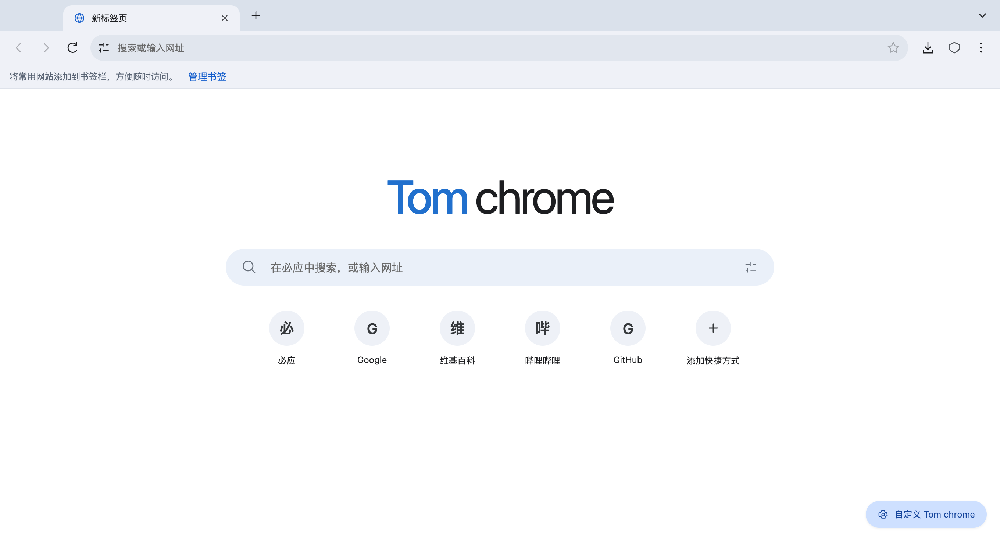
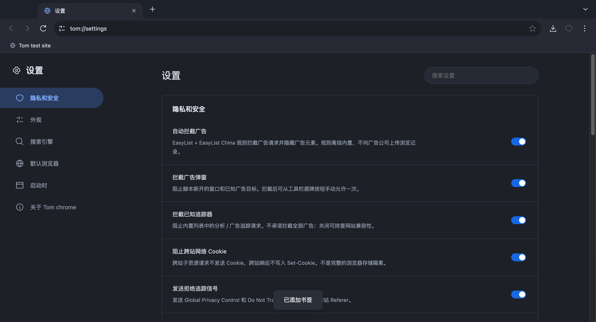
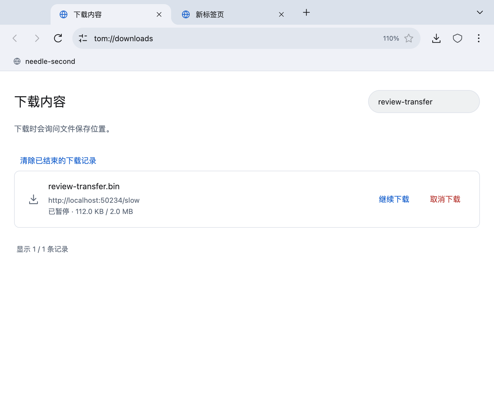
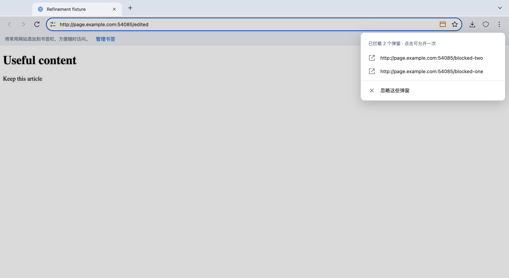

<p align="center">
  
</p>

<h1 align="center">Tom chrome</h1>

<p align="center">
  <b>无需账号的 macOS Chromium 桌面浏览器</b><br>
  本地优先 · 默认拦截广告 · 独立真实 Tor 窗口 · Chrome 风格界面<br>
  当前版本 <b>1.3.1</b> · Apple Silicon (arm64) · Electron 45.3.2 / Chromium 156
</p>

## 界面预览



*新标签页：大搜索框 + 可自定义快捷方式（最多 10 个，仅本机保存）*



*设置页（深色主题）：隐私和安全 — 广告 / 弹窗 / 追踪 / 跨站 Cookie / 拒绝追踪信号逐项可控*


*真实网站：B 站视频实际播放（普通窗口）*



*下载管理器：真实暂停 / 继续 / 取消，重启后未完成下载标记为“已中断”*



*地址栏弹窗拦截入口：可放行其中一个被拦截的弹窗，或忽略*

## 下载与安装

到 **[Releases 页面](https://github.com/Tomhao10225101490/TomChrome/releases/latest)** 下载最新版：

- **Tom-chrome-1.3.1-arm64.dmg**（推荐）：打开后把 **Tom chrome** 拖入“应用程序”即可。
- **Tom-chrome-1.3.1-arm64.zip**：解压后把 **Tom chrome.app** 放到任意位置双击运行。

系统要求：Apple Silicon Mac（M 系列芯片）。运行成品不需要 Node.js、npm 或源码。

> 应用未做付费 Apple 开发者签名 / 公证，第一次打开如果被系统拦截，请右键点应用选“打开”确认一次即可，不要全局关闭 Gatekeeper。

浏览器本身不用注册任何账号；网站自己的账号仍可正常登录。资料保存在 `~/Library/Application Support/Tom chrome/`，不读取、不修改你已有的 Google Chrome 资料。

## 核心特性

- **默认广告拦截**：Ghostery 开源过滤引擎 + 内置 EasyList / EasyList China / EasyPrivacy 离线规则（2026-11-16 快照），阻断广告与追踪请求、隐藏广告位、拦截广告弹窗；盾牌按钮可按站暂停或一次性放行弹窗。
- **三种窗口模式**：普通窗口（本地保存书签 / 历史 / 设置）、无痕窗口（独立非持久存储，不记历史）、**Tor 窗口**（随应用附带 Tor 进程，SOCKS5-only 无直连回退，出口验证 `IsTor: true` 后才开放浏览，每个窗口独立、最多两个）。
- **隐私防护**：阻止跨站网络 Cookie、发送 Global Privacy Control / Do Not Track 信号、HTTPS 自动升级、网站权限按标签与来源隔离。
- **完整的日常功能**：真实标签页（排序 / 搜索 / 重开）、书签管理、可搜索历史、下载管理、网页查找、缩放 / 静音、打印 / 保存、开发者工具、深浅主题。
- **本地优先**：本地 JSON 资料原子写入 + 有效备份恢复；拦截规则离线内置，不向第三方上传访问网址。

> 这是独立实现，不是 Google Chrome，也不是 Tor Browser 级别的匿名产品；详细边界说明见下方完整文档。

## 从源码运行

```bash
git clone https://github.com/Tomhao10225101490/TomChrome.git
cd TomChrome
npm install
python3 scripts/bundle-tor.py   # 拉取 Tor 组件到 vendor/tor（构建 Tor 窗口功能需要）
npm start                        # 开发运行
npm test                         # 单元测试（37 项）
npm run dist                     # 打包 macOS dmg + zip 到 dist/
```

---

无需浏览器账号的 macOS Chromium 桌面浏览器。保留默认广告拦截、独立真实 Tor 窗口和 Chrome 风格界面，不包含浏览器账号头像 / 登录 / 同步入口。

## 1.3.1 图标与文件清理

图标采用Chromium仓库中Chrome/Chromium共用产品标志的原始SVG路径，仅将四种填色换成蓝 / 青 / 紫配色。轮廓、三瓣分割、中心圆和白环比例均不改动；原文件、来源与许可证在 `assets/branding/`。应用ICNS和浏览器内设置页标志同步更新，仍为独立Tom chrome，不表示Google官方产品。

本版已从最终DMG安装，37项单元、20项常规、13项综合、7项原生快捷键回归及实际设置页图标加载通过；完整功能/媒体/性能结果另见1.3记录，不把旧版Tor结果冒充本次成功。证据 `evidence/install-1.3.1.json`、`unit-tests-1.3.1.txt`、`logo-1.3.1-in-app.png`。

按用户要求清理了约2.81GiB过期安装包、旧性能基线、重复解包应用和图标编译中间文件。仅保留当前DMG/ZIP与 `dist/rollback/Tom-chrome-1.3.0-arm64.dmg` 最近回滚安装包；所有真实资料备份不作为废弃文件删除。源文件和必要验证证据仍保留。后续每个版本验证完成后执行同样的有界清理，详见 `evidence/cleanup-1.3.1.json`。

## 1.3 全面回归与日常优化

- 标签切换 / 新建时清除旧地址草稿，显示实际目标网址；重新创建网页视图后保持静音与标签缩放。内置页面也可取消静音；标签支持方向键、Home / End 和单一键盘焦点。
- 历史、书签、下载每批显示100条，点击“加载更多”逐批展开，搜索仍覆盖完整列表。已用1万条合成历史检查；多窗口更新只刷新列表，不重建搜索输入框，不丢查询和焦点。
- 下载管理器增加真实暂停 / 继续 / 取消，实测暂停后字节停止、继续后前进；重启时未完成的旧下载标记“已中断”，不伪装成仍在下载，也不删除已保存文件。进度更新合并，避免高频重建整页。
- 普通 / 普通无痕窗口的活动网页可请求 HTML 视频全屏，仍受 Chromium 用户激活与 frame Permissions Policy 限制。浏览器显示来源和 Esc 提示3秒，再使用完整视口；Esc 和 ⌘L 可退出，⌘L 恢复地址栏焦点。Tor 仍拒绝该权限。
- 网站临时权限按标签 / 来源 / 当前主文档隔离，跳转后失效；麦克风批准不自动变成摄像头批准。修复“允许”后检查仍无条件拒绝的问题。原生权限 API 生命周期使用本地受控网页和模拟对话框回答验证，不代表真实硬件、定位供应商或系统通知投递已验证。
- 加强坏历史 / 书签 / 下载记录、标签网址和隐私设置结构校验，优先恢复有效备份；操作失败不再被后续成功提示覆盖。

实际最终安装包的常规 / 隐私 / 快捷方式 / 综合 / 权限 / 升级 / 原生快捷键回归及性能验收通过；B站和用户指定页面的主视频普通窗口实播通过。Tor本轮两组检查均在90秒引导上限超时，未验证当前出口，保持失败阻断；具体证据和未验证项见下文。

## 1.2.1 主视频播放修复

修复普通窗口中 `missav.ws` 主播放器向已知 `surrit.com` 媒体 CDN 请求播放列表时被防盗链返回 403 的兼容问题。仅允许重复请求中已声明的同源 Origin 作为 origin-only Referer，不传视频页面路径、查询参数或 Cookie，不关闭广告 / 弹窗拦截。保持 HTTPS、资源类型和源站 / CDN 配对校验；Tor 不使用此例外。

按用户给定链接验证的是 blob-backed **主播放器**的连续播放和拖动，不是页面短预览。诊断仅保存状态、尺寸和请求状态码，未保存页面截图、视频文件或响应内容；测试使用隔离资料。Cloudflare 验证和网络拒绝仍可能阻止某次访问，不能保证所有域名或全部视频通用。

## 1.2 响应速度优先

- 历史 / 标题 / 标签恢复资料合并为 250ms 批次，使用非阻塞文件写入；原子替换、`fsync` 与有效备份保留。书签 / 设置等明确操作等待异步持久化，正常退出会等待最后一批写完；写入失败会提示，退出保存失败时不静默丢数据。异常断电 / 强制结束仍可能丢失最后一小段后台变更。
- 标签节点按 ID 复用，只更新变化的标题 / 状态，不因拦截计数刷新而重建整条标签栏；未变化的书签栏、窗口尺寸与布局 IPC 不重复处理。
- 主进程状态推送按事件循环合并；菜单先可操作，再异步生成紧凑网页预览，不等完整 PNG 编码才显示。
- 广告列表随包提供经过校验的预编译缓存，避免首次网页请求时现场解析数兆规则；校验失败回到原文本规则，不关闭拦截。
- `npm run test:performance` 使用隔离资料、1 万条合成历史、真实本地 HTTP 页面，分别记录启动、新建 / 关闭 / 切换标签、菜单可操作与预览延迟。它不是互联网下载测速或与官方 Chrome 的排名比较；最终成品数据在 `evidence/performance-e2e.json`。

## 1.2 日常体验优化

- 新标签页可真正添加、修改和删除最多 10 个快捷方式，重启后保留；仅本机保存，不预取网址，无痕 / Tor 页不显示或写入快捷方式。
- 标准 CSS 广告隐藏会随主页面 DOM 变化限频更新，处理晚加载广告位。隔离 preload 仅传递有大小上限的 class / id 选择器词，不传正文、表单、Cookie 或 HTML，也不向网页暴露桥接。
- 地址栏出现被拦截弹窗入口，可指定放行其中一个，或忽略；盾牌仍可放行最近一个。
- 标签页右键菜单支持复制标签页、关闭其他标签页和关闭右侧标签页。
- Tor 启动、取消、关闭和重试可安全交错；旧任务不能覆盖新代理，取消的引导会结束并清理进程。联网验证和禁止直连的规则不变。
- 本地书签 / 历史 / 偏好 / 快捷方式 JSON 使用原子写入和 `0600` 最近有效备份。损坏时保留原件、读取上一有效版本并提示；主文件和备份都不可读时停止启动，避免静默覆盖。它不备份整个网站 Cookie 数据库。

这是独立实现，不是 Google Chrome 或 Tor Browser，也不是经过逐像素认证、功能完全相同的 Chrome 复制品。

## 直接打开

- 双击项目文件夹中的 **Tom chrome.app**，或打开 `~/Applications/Tom chrome.app`。
- 最新安装包：`dist/Tom-chrome-1.3.1-arm64.dmg`。
- 压缩包：`dist/Tom-chrome-1.3.1-arm64.zip`。
- 适用 Apple Silicon Mac；运行成品不需要 Node.js、npm、源码或开发服务器。
- 应用未经过付费 Apple 开发者签名 / 公证；其他 Mac 可能显示系统验证提示。不要全局关闭 Gatekeeper。

浏览器本身不用账号；网站自己的账号仍可登录。正常资料目录是 `~/Library/Application Support/Tom chrome/`，不读取或修改你已有 Google Chrome 的资料。

## 广告拦截：默认开启

使用 Ghostery 开源过滤引擎和内置 **EasyList + EasyList China + EasyPrivacy** 规则：

- 阻断已知广告 / 追踪网络请求。
- 用规则匹配的 CSS 隐藏广告位，保留正常正文。
- 阻止脚本新开的广告式窗口、已知广告目标，以及网页内指向已知广告网络的跨站跳转。
- 普通的、新标签页打开的链接仍然可用。
- 盾牌按钮显示本窗口广告 / 追踪 / 弹窗拦截情况。可选择 **在此网站暂停广告拦截**，或 **允许最近拦截的弹窗（仅一次）**。暂停按当前主机名保存，普通模式下也暂停该站的列表追踪拦截，但不关闭 Cookie / HTTPS / Tor 安全限制，不全局关闭保护。
- 设置里可分别调整广告、弹窗、追踪、跨站网络 Cookie、拒绝追踪信号和 HTTPS 升级。

同一规则机制适用于普通网站和成人网站；已验证 ExoClick、TrafficJunky、JuicyAds、MagSrv、HighPerformanceFormat 等广告网络被规则匹配。这些广告网络的覆盖使用规则和受控测试验证；另按用户提供的链接进行了实际主播放器兼容检查，仅保存技术元数据，不保存页面截图或视频文件。

**不是所有广告都能去掉。** 视频内嵌广告、网站自己拼接的推荐、未知广告域名、某些遮挡层或反广告拦截系统可能无法处理。没有承诺绕过付费墙，也没有启用规则中的 JavaScript 脚本注入或扩展选择器。网络规则和主页面标准 CSS 是本版实际启用的能力。

规则为 **2026-11-16 离线快照**，第一次打开即生效，不向第三方上传访问网址。当前随应用版本更新，不会暗中连接订阅服务，也不声称有实时规则自动更新。规则来源、校验值及许可证见 `THIRD_PARTY_NOTICES.md`。

## 普通、无痕、Tor：三种模式要分清

### 普通窗口

保留书签、历史、网站持久 Cookie 和设置；使用系统网络配置。防追踪不是匿名代理，网站仍能看到此网络的出口 IP。

### 无痕窗口

菜单 **新建无痕窗口** 或 `⇧⌘N`。使用独立的非持久网站存储，不记录历史。它仍使用系统网络，不隐藏出口 IP。下载的文件和主动保存的书签会保留。

### Tor 窗口

菜单或盾牌按钮选择 **新建 Tor 窗口**：

1. 单独启动随应用提供的 Tor 0.4.9.17 进程。
2. 为该窗口设置 SOCKS5-only 代理，显式关闭 Chromium 对本地地址的代理绕过；不配置 DIRECT 回退。
3. Tor 引导后，由**同一个窗口会话通过 SOCKS5**请求 Tor Project 的出口检测接口，确认 `IsTor: true` 后才显示 **Tor 已验证**、开放浏览。
4. 未连接 / 未验证 / 进程退出 / 用户断开时阻断请求，不因失败退回普通网络。
5. 关闭窗口后停止它的 Tor 进程，清理临时网站存储。每个 Tor 窗口独立，最多同时两个。

普通窗口和普通无痕窗口**不会**因为另开了 Tor 窗口而匿名。Tor 直接连接 Tor 网络，不自动套用系统代理；本版尚未集成网桥 / 混淆传输。引导有 90 秒上限，出口验证有 25 秒上限，失败后需要用户主动重试。

Tor 窗口还会限制：

- 拒绝本地 / 私有网络目标及硬件类网站权限。
- 禁止非代理 WebRTC UDP，禁用 QUIC。此前1.2实际 ICE / STUN 测试没有直连 UDP 包或 IP 候选；1.3实时出口检查受网络引导超时阻挡，未到该阶段。
- 不把 Tor 浏览记录或标签恢复数据写入普通资料。
- 下载前明确提示外部文件泄漏风险；保存书签前提醒会记录网址到本机。
- 禁用网页另存为、打印、从下载列表打开外部文件，避免外部程序或打印服务绕过 Tor。

**重要边界：这仍不是 Tor Browser 级别的匿名产品。** 没有它的统一指纹、letterboxing、完整第一方隔离、安全级别、网桥体系和同等级更新发布流程。字体、屏幕、Canvas / WebGL、浏览习惯、账号登录和网站内容都可能关联身份。登录实名账号、安装系统恶意软件、用外部应用打开文件，都可能失去匿名性。高风险匿名需求应使用持续维护的官方 Tor Browser；不要把本应用的 Tor 出口验证当作完整安全审计。

## B 站“版本过低”的说明

你提供的 `https://www.bilibili.com/blackboard/fe/activity-CjJbuaD7Xw.html` 本身就是固定的 **浏览器下载建议页**。本机官方 Chrome 打开相同链接也显示“版本过低”，并非该页面在实时检测内核年龄。我们没有删除或隐藏网站的这段文案来假装修复。

1.3 继续使用 Electron **45.3.2 / Chromium 156**；User-Agent 移除 Electron / Tomchrome 产品标记，使用真实 Chromium 主版本的标准化形式，不伪造更高内核版本。

已实际验证：

- `https://www.bilibili.com/` 首页正常显示。
- 通过真实首页进入视频，播放器实际播放、时间前进、具有视频画面尺寸，无媒体错误。未用替代视频、截图或本地样本冒充。
- 提示页本身仍会显示其固有文案；正常浏览请从 B 站首页或真实视频链接进入。

1.2 还修复了视频 CDN 防盗链导致的重复 403 / 长时间加载：仅在普通模式的已知 Bilibili 媒体 CDN 请求中，允许重复该请求 **Origin 已经声明的站点来源** 作为来源 Referer，不传视频路径、查询参数或 Cookie；DNT / GPC 保留。未声明同源 Origin 的请求不例外，其他跨站请求仍剥离 Referer，Tor 不使用该兼容例外。对照记录：`evidence/bilibili-1.2-ab-diagnostic.json`、`bilibili-referrer-diagnosis.json`。

## 其他已有功能

真实独立标签页、前进 / 后退 / 刷新 / 停止、标签排序 / 搜索 / 重新打开、书签管理、可搜索历史、下载 / 文件位置、网页查找、缩放 / 静音、打印 / 保存 HTML、开发者工具、深浅主题，以及请求设为系统默认浏览器。敏感外部文件在打开前另行警告；本版没有恶意文件云扫描服务。

常用快捷键：

- `⌘T` 新标签，`⌘W` 关闭，`⇧⌘T` 重新打开。
- `⌘N` 新窗口，`⇧⌘N` 普通无痕窗口（不是 Tor）。
- `⌘L` 地址栏，`⌘R` 刷新，`⇧⌘R` 强制刷新。
- `⌘[` / `⌘]` 后退 / 前进；`⌃Tab` / `⌃⇧Tab` 切换标签。
- `⌘1`—`⌘8` 选择标签，`⌘9` 最后一个标签。
- `⌘D` 添加 / 移除书签，`⌘F` 网页查找。
- `⌘+` / `⌘-` 缩放，`⌘0` 原始大小。
- `⌘Y` 历史，`⇧⌘J` 下载，`⌘,` 设置。
- `⌘P` 打印，`⌘S` 保存，`⌥⌘I` 开发者工具。

## 升级与数据

升级合并新选项，保留已有书签、历史和偏好；真实安装包升级测试会另外验证恢复标签和持久 Cookie。新快捷方式与书签相互独立，不改写已有书签。

本机升级前会正常退出旧应用，并将完整资料备份至：
`~/Library/Application Support/Tom chrome Backups/pre-1.3.1-*/profile/`

正常运行的 JSON 自动备份为资料目录中的 `browser-data.json.bak`，保留上次有效版本，可能比最后一次操作早一代。损坏原件保存为 `browser-data.json.corrupt-时间戳`。敏感本地备份也应像原资料一样保护；需要完整恢复时，先正常退出应用再处理资料目录。

自动恢复目前只保存第一个普通窗口的标签网址，不恢复所有窗口布局、表单、滚动位置或完整导航栈。会话 Cookie 不保证退出后保留；持久 Cookie 按网站设置保存。更强的跨站网络 Cookie 限制可能影响嵌入登录或播放器，可在设置中排查。此选项处理的是请求 Cookie 和响应 Set-Cookie，不是完整的第三方 JavaScript 存储隔离。

## 未提供 / 未完整验证

没有 Google 浏览器账号同步、Chrome 网上应用店安装、完整扩展 API、Chrome 密码管理器 / 自动填充、Widevine DRM、Google Safe Browsing 云服务、PWA 安装、Chrome 全套企业策略及应用自动更新。部分 OAuth 弹窗需要手动允许；某些受保护视频可能不兼容。

真实硬件权限、定位服务、系统通知投递、打印机、实际网站账号登录、系统默认浏览器确认与桥接 Tor 网络未声称已验证。未保存表单的完整关闭前保护提示尚未实现；关闭 / 升级前应先保存网页工作。本次没有变更系统默认浏览器。应用未公证，也没有安全更新服务器；不要把固定版本长期不更新地用于高风险浏览。

## 验证证据

1.3最终成品使用隔离资料复验，安装自经过校验的最终DMG，源文件与安装ASAR一致。启动297.8ms；本机热缓存 / 本地受控环境下新建、关闭、切换标签p95为15.7 /16.7 /16.1ms，菜单可操作p95为17.6ms；不是互联网速度或Chrome排名。真实资料在隔离测试期间未变更，正常启动后书签 / 偏好 / 快捷方式 / 历史网址保留。

- `evidence/install-1.3.0.json`：安装、正常退出、完整私人资料备份、回滚路径、源/安装一致性和真实资料保留。
- `npm test`、`evidence/unit-tests-1.3.0.txt`：36项单元测试，包括坏资料、分权限授权、异步保存、广告、媒体来源和Tor启动取消。
- `evidence/comprehensive-e2e.json`：13项新综合检查，1万条合成历史、跨窗口同步、真实下载字节进度、全屏/原生Esc/⌘L、静音/缩放和地址正确性。
- `evidence/permissions-e2e.json`：3项原生权限API检查，明确对话框回答模拟及硬件验证边界。
- `evidence/packaged-e2e.json`：安装成品 20 项常规端到端检查。
- `evidence/privacy-e2e.json`：8 项广告 / 隐私 / 弹窗检查，明确为本地受控测试。
- 本次Tor失败：`evidence/tor-e2e-failure-1794841201254.json`、`tor-lifecycle-failure-1794841292604.json`；两组各到90秒引导上限，未验证出口。已通过的部分为启动锁定、本地地址阻断、关闭取消和三轮快速断开重试；不是全套通过。
- `evidence/refinements-e2e.json`：9 项快捷方式 / 动态广告 / 弹窗选择 / 标签菜单 / 真实坏资料恢复检查，使用本地受控服务。
- 旧版完整Tor成功证据已归档至 `evidence/releases/pre-1.3-review/` 和 `releases/1.2.0/`，不得当作1.3当前网络实测成功。
- `evidence/upgrade-e2e.json`：最近一次真实安装包升级测试（实际版本见文件），资料为合成测试资料；旧版本升级证据另行保留。
- `evidence/bilibili-video.json`、`bilibili-homepage.json`：真实互联网 B 站验证。
- `evidence/installed-smoke.json`：成品路径 / 版本、原生键盘事件、真实必应搜索、菜单预览。
- `evidence/performance-before.json`、`performance-e2e.json`：同机、同一脚本的性能优化前 / 最终成品延迟，包含精确应用哈希、原始样本和测量边界。
- `evidence/site-media-probe-installed-1.3.0.json`：用户指定页面主播放器720p，连续前进11.95s，跳至60s后继续至63.13s，无媒体错误；仅技术元数据，不含视频内容或页面截图。
- `evidence/SHA256SUMS.txt`：当前1.3.1安装包及应用资源哈希；旧安装包已清理，保留的旧哈希仅作历史记录，不代表文件仍可用。1.2.1原证据在 `evidence/releases/1.2.1/`。

测试使用 `/tmp/tom-*` 隔离资料；没有读取用户 Chrome 资料或用你的账号做测试。证据中的 Tor IP 是公开 Tor 出口，不是本机真实地址。第三方许可证见 `THIRD_PARTY_NOTICES.md` 及打包资源内的 Tor licenses。

## 开发 / 重建

```sh
npm ci --cache /tmp/tom-chrome-npm-cache
npm start
npm test
npm run test:e2e
npm run test:privacy
npm run test:refinements
npm run test:comprehensive
npm run test:permissions
npm run test:performance
npm run test:tor
npm run test:tor-lifecycle
npm run build
npm run dist
```

构建复用 `node_modules/electron/dist`。ARM64 Tor 依赖已随项目提供；重建其 bundle 可运行 `python3 scripts/bundle-tor.py`，使用固定校验值，不需要 root 或系统安装 Homebrew。`TOM_PROFILE=/绝对路径` 指定隔离资料；`TOM_EXECUTABLE=/路径/Contents/MacOS/Tom\ chrome` 供测试成品使用。Tor 测试需要真实可达的 Tor 网络，失败不能当作通过。
